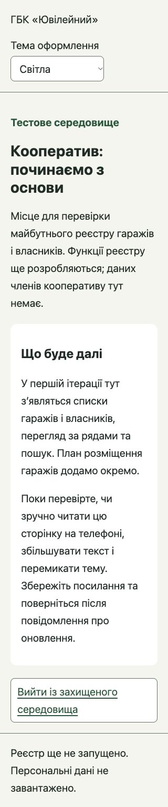
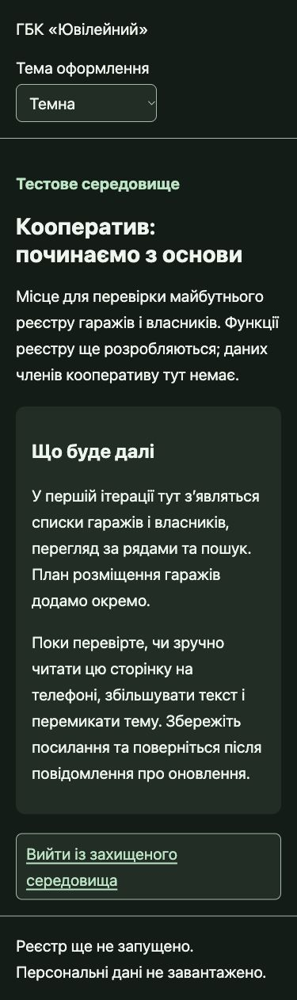

# Перевірка середовищ 10 листопада 2026

Розгорнутий код: `4cdebd576ac3c2a68629b62d1bdfb9cc6902fe2d`.

- Staging version: `8de7f7ea-6c52-4944-bcd8-44d7913a87fb`.
- Production version: `05f5bccd-b7f4-4eec-a5fd-2fd504734438`.
- `npm run check` (Node 22.23.2): lint, Prettier, 7 тестів, dry-run staging і production — пройдено.
- PR: GitHub Actions `Lint, format, tests, build`, `Secret scan` та `Workers Builds: cooperative` — пройдено.

## Віддалені перевірки

- На обох адресах неавторизовані `/`, `/api/health`, `/styles.css`, `/api/owners` повернули HTTP 302 на домен Cloudflare Access.
- Вхід через наявний акаунт Cloudflare, вихід і повторний вхід перевірені на staging та production. Вхід саме з акаунта Володі має перевірити Володя; чужу сесію не використовували.
- Після входу health обох Workers повернув `ok: true` та відповідно `staging` / `production`.
- Через Cloudflare API звірено реальні bindings: різні D1 UUID та назви R2, правильний APP_ENV.
- `SELECT 1` у кожній віддаленій D1 успішний. Публічні R2 managed domains вимкнені. Дані не імпортувалися; міграцій не виконували.
- Cloudflare Builds production та preview налаштовані на dry-run. Після push код production не публікується автоматично.

## Інтерфейс і доступність

Самостійно пройдено стартову сторінку українською: прочитати призначення → змінити тему → оновити → вийти → увійти знову. Функцій реєстру та форм введення даних тут поки немає; це прямо сказано на сторінці.

- Staging: 320 і 375 px, світла/темна теми; ширина документа дорівнює viewport, немає горизонтального переповнення.
- Production: 375 px, обидві теми, настільний розмір. Правильні текстові позначки середовищ.
- Тема зберігається після оновлення; системний режим прибирає ручне перевизначення.
- Клавіатура: видимий фокус, перехід до змісту, доступ до перемикача теми й виходу.
- axe-core у jsdom: 28 успішних правил, 0 порушень. Дві неповні перевірки landmarks/heading вручну підтверджено в DOM опублікованої сторінки: один main і один h1. Це структурний аудит, не повний axe-аудит у реальному браузері.
- Контраст обчислено за фактичними CSS-кольорами: текст ≥12.90:1, акцентний текст ≥7.69:1, межі елементів ≥4.89:1.
- Перевірка фізичного телефона, екранного читача та масштабу 200% залишається частиною приймання першої ітерації. Підтримувана мова стартової сторінки — українська; сторінка входу Cloudflare має власний англомовний інтерфейс.

